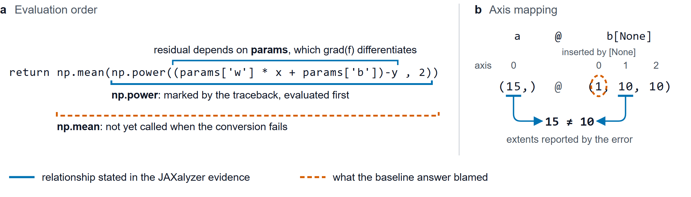

# JAXalyzer: JAX Dependency Mapping Tool for Agentic Debugging

## Abstract

A JAX traceback can identify a failing line while leaving a debugger to determine which call ran first, where its operand came from, or which tensor axis violated a constraint. JAXalyzer applies source and traceback rules to state those relationships in a debugging model's prompt, increasing error diagnosis accuracy. We evaluated reviewed JAXalyzer evidence on 90 JAX debugging tasks with Gemma 4 12B, scoring one answer per case in each condition. Given the same source and traceback, Gemma produced 25 fully correct diagnoses without the evidence (27.8%) and 38 with the evidence (42.2%), resulting in a gain of 14.4 percentage points in performance for an additional 628 input tokens per case. On a smaller 17 case pilot, GPT-6-Luna also had a gain of 23.5 percentage points in accuracy on 17 tasks, raising correct cases from 10 to 14.

## 1. Introduction

Debugging agents often fail to correctly identify causes of JAX traceback errors due to their lack of dependency awareness. Here, an author fitting a straight line used JAX to differentiate a mean squared error [7]. The loss function ended with the expression below. In our CPU replay, the traceback marked the part of the line active when NumPy tried to convert a traced array.


**Figure 1. Two source relationships used in JAX diagnosis.** (a) Which call executes first. (b) Which operand axes must match. Solid blue marks show the relationships identified by JAXalyzer. Dashed orange marks show what baseline Gemma blamed.

We tested Gemma 4 12B to diagnose the error, and Gemma's baseline answer blamed `np.mean` (Figure 1a). A JAX tracer stands for a value during a program transformation such as differentiation, and asking NumPy to materialize it as an ordinary array raises an exception [1]. Both NumPy calls on this line are plausible suspects, but Python must evaluate the argument to `mean` before calling it. Here `np.power` receives the residual, which depends on the weight and bias being differentiated. An engineer who follows the baseline diagnosis could replace the reduction and still encounter the same exception.

A separate notebook illustrates a different problem (Figure 1b, case NB-060 [9]). JAX reported a mismatch between 15 and 10 in `a @ b[None]`. Gemma blamed the new leading axis introduced by `None`, although that axis has size 1. Using the reconstructed notebook source, JAXalyzer traced the reported 10 to the middle axis of `b[None]`, which the multiplication pairs with the length-15 vector. With that evidence, Gemma identified the middle axis correctly.

The traceback and source already contain the clues to this distinction. What does a debugging model gain if a tool works out the relationship and cites the expressions that support it? We built JAXalyzer to answer that question for two failure types common in numerical Python: conversions of traced values and operations on incompatible shapes. We contribute:

1. a rule-based method that derives source relationships from a saved failure and states their limits (Section 3);
2. 90 source-backed diagnosis tasks with frozen answer keys (Section 4);
3. a paired, arm-blind study of Gemma 4 12B that reports accuracy, the grade change behind each discordant pair, and the facts the answers express (Sections 5 and 6).

## 2. Related work

**Error guidance and shape tools.** JAX's error guide explains why a NumPy conversion fails inside a transformed function [1], but a debugger must still connect that explanation to a particular expression. PyTea statically collects PyTorch shape constraints whose unsatisfiability signals a possible failure [2]. TensorSensor, the closest shape tool, augments a tensor exception at run time with the failing operator and its operand shapes, for libraries including JAX [3]. JAXalyzer starts with a saved failure that is not executed again, attributes reported extents to operand axes and source producers, and writes for a model.

**Runtime evidence.** ChatDBG lets a language model query a debugger [4], and LDB supplies intermediate runtime values to help a model debug generated programs [5]. Our setting has no live session. A rule relates facts already present in a saved notebook or issue report before the model gives its single answer.

**Debugging context.** Porbeck et al. vary the context supplied to an LLM across 93 configurations. They find that failure-specific artifacts improve failure explanations while very large contexts make them vague, and they validate their model judge against human ratings [6]. Our experiment is one controlled instance: a short derived addition to an otherwise identical prompt.

## 3. How JAXalyzer maps a failure to source

### 3.1 Inputs and rules

JAXalyzer reads a diagnostic packet: the recorded traceback and line-numbered application source. It extracts the exception type, the marked application frames, and the expressions they select, and runs it through a variety of rules, obtained and generalized by screening 547 GitHub issue reports for recurring JAX errors. The conversion rules inspect the selected expression and the value passed into it. The shape rules inspect the operator, its operands, and the extents the exception reports. If the analyzer recognizes the error and matches a rule, it runs its matching probe and tracing algorithm to map the dependencies related to the instance.

The output is an evidence card appended to the unchanged baseline prompt. A card lists the executed traceback sites, upstream source lines and producer expressions, one reviewed relationship, and computed facts such as evaluation order, the differentiated argument, or an axis mapping. Each card states its limits. A caret spanning a call with several operands establishes the call site and leaves the responsible argument open.

### 3.2 One hint from start to finish

For the loss function above (case FORUM-002), the last two parts of the released card read:

```text
Reviewed trace relationship and its scope
The recorded `np.power` call receives `params['w'] * x + params['b'] - y` as its
first operand. [...] The live backend object, nested subcall responsible for
conversion, and values inside an operand remain unresolved unless separately
recorded.

Computed operand and evaluation facts
- Packet line 11, `f`: caret selects `np.power(params['w'] * x + params['b'] - y, 2)`
  inside `np.mean(...)`. Python has to evaluate that subexpression before invoking
  the enclosing call.
- Source lines 29 and 34: `grad(f)` differentiates `params` (zero-based parameter 0).
```

The first fact comes from matching the caret span to a call in Python's syntax tree and finding its enclosing call. The second comes from the assignment `df = grad(f)` and the signature `f(params, x, y)`, because `grad` differentiates the first positional argument by default [8]. Using this, Gemma was able to correctly identify the cause; the baseline answer from Gemma was incorrect ("**Operation:** `np.mean(...)` (specifically the call to `np.mean` on a JAX tracer).") and the assisted answer was correct ("**Operation:** `np.power` (specifically, the internal call to the `__array__` method of a JAX Tracer).").

## 4. Evaluation design

**Cases.** We assembled 90 diagnostic tasks from public notebooks, project and community reports, teaching examples, and regression cases. Each provides application source, a recorded exception or a CPU replay of a published example, and evidence supporting a diagnostic key. The 90 cases came from 78 source groups and covered four errors: converting traced values to NumPy arrays (40) or Python scalars (15), multiplying arrays with incompatible dimensions (27), and reshaping arrays to incompatible sizes (8).

**Comparison.** Baseline Gemma received the question, source, and traceback. Assisted Gemma received the same prompt with the evidence card appended. Both used the instruction-tuned, quantization-aware-trained checkpoint `gemma-4-12b-it-qat-w4a16-ct`, version 2 [10], on four NVIDIA L4 GPUs with temperature 0, thinking disabled, a 768-token output limit, one user message, one generation per case, and no tools.

**Scoring.** The question asks for the operation that raises, its immediate operand or constraint, the origin of that operand or constraint, and a source citation. Each case had a reference key before inference. A *correct* answer identifies the operation and operand or axes, explains the cause to the depth of the key, and cites matching evidence without a conflicting causal claim. A *partial* answer establishes part of that diagnosis or omits the citation. An *incorrect* answer blames the wrong operation, operand, or axis, or contradicts a required fact. Only correct answers counted toward accuracy.

**Analysis.** We counted how often the evidence changed a wrong diagnosis to a correct one and how often the reverse happened. We tested whether that difference was larger than expected by chance using an exact two-sided McNemar test. To estimate uncertainty, we recalculated the accuracy gain in 5,000 resampled datasets, keeping cases from the same source together. Because earlier results guided the rules and model choice, the gain still needs to be tested on new cases.

## 5. Results

### 5.1 Diagnostic accuracy and inference cost

**Table 1. Gemma 4 12B diagnosis and inference cost on 90 paired cases.**

| Measure | Baseline | JAXalyzer assisted |
|---|---:|---:|
| Fully correct | 25 (27.8%) | 38 (42.2%) |
| Difference, percentage points | | +14.4 |
| Gains / losses | | 15 / 2 |
| Exact McNemar *p* (exploratory) | | 0.00235 |
| 95% source-owner bootstrap interval | | +6.5 to +23.2 |
| Mean input tokens per case | 1,280 | 1,908 |
| Mean output tokens per case | 281 | 279 |

The baseline job took 448.5 seconds. The fresh assisted job scored 37/90 in 496.5 seconds. Before the answers were inspected, two evidence cards were rejected in source review. Using the saved answers to the earlier reviewed prompts for those cases gives the reported 38/90.

By task family, correct diagnoses in the JAXalyzer assisted set moved from 13 to 18 of 40 array conversions, 6 to 6 of 15 scalar conversions, 4 to 11 of 27 contractions, and 2 to 3 of 8 reshapes. In an earlier exploratory pilot with a previous evidence version, Luna's correct diagnoses rose from 10/17 to 14/17 on cases that also appear in this cohort.

### 5.2 What changed in the discordant pairs

**Table 2. Grade changes in the 17 discordant pairs.**

| Baseline grade → assisted grade | Pairs | Reason for the lower grade |
|---|---:|---|
| Incorrect → correct | 10 | Wrong operation or library (5); wrong axis (4); wrong origin (1) |
| Partial → correct | 5 | Required origin of an operand or extent omitted (5) |
| Correct → incorrect | 1 | Wrong axis |
| Correct → partial | 1 | Required origin omitted |

None of the 15 gains was attributed solely to a missing citation. In the wrong-axis loss, Gemma called 3 the row dimension of a (50, 3) weight despite the supplied axis mapping. Across all 90 pairs the evidence also moved eight incorrect answers to partial and four partial answers to incorrect.

## 6. Which facts the answers express

We checked whether this pattern held across 43 cases where Gemma had missed full credit with an earlier version of JAXalyzer. For each case, we chose one source fact in advance, such as which axis caused a shape mismatch. With JAXalyzer, Gemma expressed that fact more accurately than the baseline in 15 cases, less accurately in three, and equally well in 25. Answers that contradicted the fact fell from 21 to 12, while answers that stated it fully rose from two to eight.

## 7. Limitations

**Limited sample size.** Due to data and formatting limitations, we were not able to create a larger benchmark with more unseen cases.

**Model-based grading.** Individual task case result categorization was completed by GPT-6-Astra on high reasoning, so an extensive deterministic scoring server was not set up.

**Controls and scope.** The evidence lengthens the prompt. A length-matched control repeating the relevant source lines would separate the value of derived relationships from the value of drawing attention to those lines. Public sources may have appeared in model training, and the case mixture does not estimate failure frequencies in deployed systems.

**Unmeasure debugging capability** The tasks asked the models to diagnose the causes of the errors, but it did not ask or measure its ability to implement a fix based on their diagnoses. Repair success would need a separate experiment in which the model edits and tests code.

## 8. Conclusion

When source and traceback jointly identify a relationship, stating it explicitly can improve the diagnosis a small model gives in a single call. Source-linked evidence raised Gemma's fully correct diagnoses on this development cohort from 25 to 38 of 90, mostly by correcting a wrong operation or axis. The next test is to recruit failures from new sources, and measure evidence coverage and diagnostic accuracy before adapting any rule.

## References

1. JAX developers. *Errors.* JAX documentation. https://docs.jax.dev/en/latest/errors.html
2. H. Y. Jhoo, S. Kim, W. Song, K. Park, D. Lee, and K. Yi. *A Static Analyzer for Detecting Tensor Shape Errors in Deep Neural Network Training Code.* arXiv:2112.09037, 2021.
3. T. Parr. *TensorSensor: Clarifying exceptions and visualizing tensor operations in deep learning code.* https://github.com/parrt/tensor-sensor
4. K. H. Levin, N. van Kempen, E. D. Berger, and S. N. Freund. *ChatDBG: Augmenting Debugging with Large Language Models.* FSE, 2025. doi:10.1145/3729355
5. L. Zhong, Z. Wang, and J. Shang. *Debug like a Human: A Large Language Model Debugger via Verifying Runtime Execution Step by Step.* Findings of ACL, 2024.
6. J. Porbeck, C. M. Adriano, and H. Giese. *From Program Slices to Causal Clarity: Evaluating Faithful, Actionable LLM-Generated Failure Explanations via Context Partitioning and LLM-as-a-Judge.* EASE (EQUISA workshop), 2026. arXiv:2604.18309
7. kankan256. Stack Overflow question 67285326. CC BY-SA 4.0. https://stackoverflow.com/questions/67285326
8. JAX developers. *jax.grad.* JAX documentation. https://docs.jax.dev/en/latest/_autosummary/jax.grad.html
9. xiaotai-yang. *NF_scalar*, `test.ipynb`, commit 66c5a51. https://github.com/xiaotai-yang/NF_scalar/blob/66c5a51365335362a3b18e646cbf6446e8cd62c0/test.ipynb
10. Google. *Gemma 4.* Kaggle Models.
